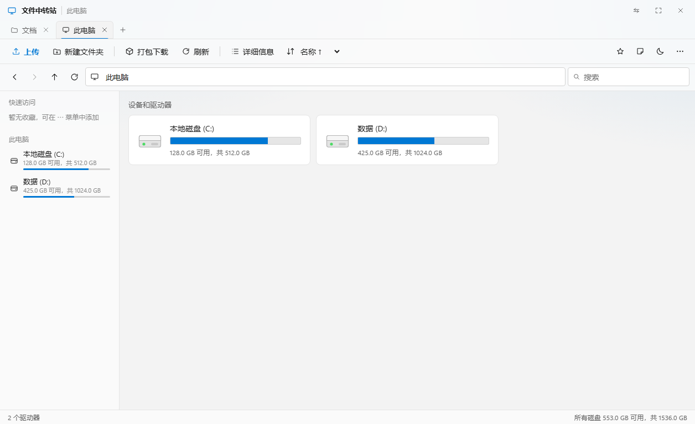
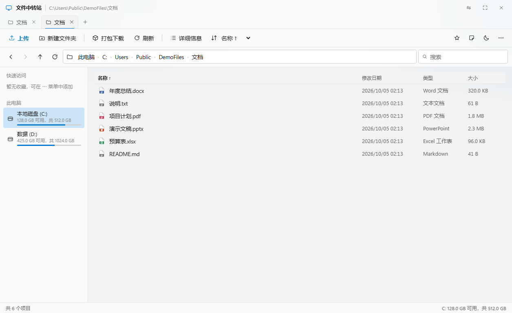
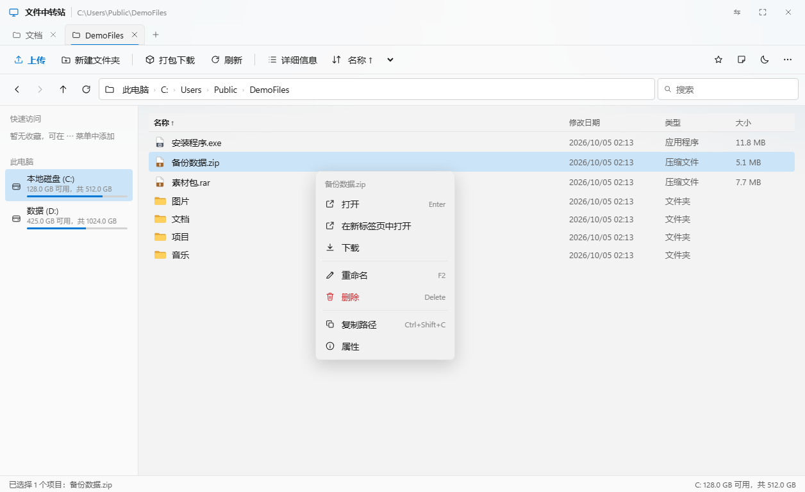
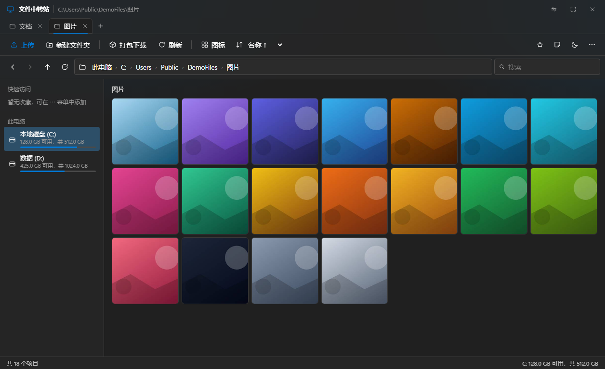

# 文件中转站（Transfer Station）

局域网文件浏览与管理服务：把电脑上任意目录变成手机 / 平板 / 其他电脑都能访问的「Windows 资源管理器」。基于 Node.js + Express，前端零框架（原生 HTML/CSS/JS），Windows 11 Fluent 视觉风格。**Windows 与 Linux 均可运行**，磁盘列表会自动切换成盘符或挂载点。



## 功能

**浏览**
- 磁盘列表（「此电脑」）：卷标、文件系统、容量条、可用空间，与 Windows 一致的呈现
- 任意目录浏览，面包屑导航、前进 / 后退 / 上一级、路径直达、六种排序（名称 / 时间 / 大小，升序降序，自然排序）
- **搜索**：默认过滤当前目录；点搜索框右侧「子目录」按钮后递归搜索全部子文件夹（跳过隐藏目录，结果数与深度有上限），结果以相对路径平铺展示
- **详细信息视图**与**图标视图**双模式：名称 / 修改日期 / 类型 / 大小四列，列头点击排序；缩略图墙用于图片视频
- **多标签页**：每个标签独立目录与浏览历史，`Ctrl+T` 新建、`Ctrl+W` 关闭、中键关闭，会话自动恢复
- **多选**：`Ctrl` 点选多个、`Shift` 连选一段、`Ctrl+A` 全选、点空白处或 `Esc` 取消；右键已选中的项目可按整个选区操作，状态栏汇总数量与总大小
- **手机端选择模式**：点地址栏的 ✓ 按钮进入，之后点条目即勾选，底部出现「复制 / 剪切 / 打包 / 删除 / 全选」操作栏
- 导航窗格：快速访问（收藏夹）+ 此电脑（各磁盘及容量条）

**媒体**
- 图片：sharp 生成缩略图并缓存、懒加载、大图查看器、键盘与手势翻页、相邻预加载、幻灯片自动播放（3/5/10 秒）
- 视频：ffmpeg 抽帧封面、内置播放器、0.5x–2x 倍速、相邻切换
- PDF：内置查看器（全屏 / 下载），其他文件按扩展名给出彩色类型图标
- **生活区照片**：⋯ 菜单打开照片面板，可批量上传、删除，缩略图网格点开即用图片查看器浏览（数据存放在 `.data/lifezone/photos/`）

**操作**
- 上传：多选、拖拽到页面、**文件夹上传（保留目录结构）**、逐个文件进度、可取消、重名自动改名；**上传队列**支持 1–4 个文件并发、暂停 / 继续、实时速度与剩余时间；开始上传后可收起面板**在后台继续传**（右下角进度胶囊可随时点开查看、暂停或取消），期间可以正常浏览、切换目录，文件仍会传到开始上传时所在的目录；开始前若目标磁盘剩余空间不足会先提醒
- 下载：单文件下载、整个目录打包 zip、多选项目一起打包 zip
- **剪切 / 复制 / 粘贴**：`Ctrl+X` 剪切（项目在列表里半透明置灰）或 `Ctrl+C` 复制，进入目标目录 `Ctrl+V` 粘贴即可；支持多选批量、粘贴到右键的某个文件夹、跨磁盘移动、同名自动加序号（`b.txt` → `b_1.txt`）；复制后剪贴板保留，可连续粘贴多份，`Esc` 取消
- **撤销**：`Ctrl+Z` 撤销上一步（移动 / 复制 / 重命名 / 新建文件夹 / **删除**），可连续撤销多步
- **回收站**：删除先进**同盘回收站**（各盘根目录下的 `.transfer-station-trash/`，盘根不可写时回落到 `.data/trash/`），同盘删除 / 还原都是瞬时移动；可整批还原（原位置被占用时自动改名），清空才真正删除
- **批量重命名**：多选后右键，支持「替换文字 / 添加前缀 / 添加后缀 / 重命名为序号」四种规则，实时预览，扩展名自动保留；改名互换这类冲突由两阶段改名处理
- **右键 / 长按菜单**：打开、在新标签页打开、下载、打包下载、复制、剪切、粘贴、重命名（行内编辑，`F2`）、删除（`Delete`）、复制路径、属性
- 收藏夹（服务端存储，多端同步）、备忘录（颜色标记 / 置顶）、新建文件夹
- **操作日志**：记录每次上传 / 新建 / 重命名 / 移动 / 复制 / 删除 / 还原 / 清空回收站 / 撤销的时间、访问 IP、动作与涉及路径，⋯ 菜单可随时查看最近 300 条
- **空间清理**：⋯ 菜单可对当前目录递归扫描**大文件**（按大小阈值）和**重复文件**（大小 + 内容哈希确认），显示可释放空间；点击任意结果会打开所在目录并**选中、滚动到该文件**（3 秒主题色描边高亮）；扫描结果支持勾选 2 个文件做**精确对比**（完整 SHA-256 + 逐字节首个差异位置），或多选做**批量对比**（按内容分组、小缩略图）；**对比结果里可直接把文件移到回收站**，删除后自动用剩余文件重新对比；点击图片/视频可用内置查看器查看，`←` `→` 切换（视频直接播放，不会触发下载）；同时最多跑 2 个任务，可中途停止
- **磁盘空间提醒**：加载磁盘时若某盘剩余低于总容量 5% 或 1 GB，状态栏会提示；上传前也会核对目标盘剩余空间
- 深色模式（首次跟随系统）、6 种主题色、紧凑模式、全屏
- **毛玻璃外观与自定义背景**：标题栏、导航、面板、菜单、对话框都是半透明磨砂玻璃；⋯ 菜单 →「界面背景」可选择本地图片，图片会**上传到服务器**（sharp 压缩到最长边 1920px，存为 `.data/background.jpg`），所有设备共用，深色模式自动加暗色蒙层，可一键恢复默认





> 以上截图使用中性示例目录（`C:\Users\Public\DemoFiles`）与合成的磁盘数据拍摄，不含任何真实个人文件或路径。

## 快速开始

要求：**Node.js ≥ 18.15**（用到 `fs.statfsSync`），建议装有 `ffmpeg`（缺失时仅视频封面失效）。

**Windows**：双击 `start.bat`（首次会自动安装依赖）。

**Linux / macOS**：

```bash
chmod +x start.sh
./start.sh
```

也可以手动 `npm install && npm start`。Linux 上若缺 ffmpeg，视频封面不可用：

```bash
sudo apt install ffmpeg        # Ubuntu / Debian
sudo dnf install ffmpeg        # Fedora
sudo pacman -S ffmpeg          # Arch
```

启动后终端会打印两个地址：

```
电脑本地访问: http://localhost:3000
手机访问地址: http://192.168.x.x:3000
```

Linux 上「此电脑」列出的是真实挂载点（`/`、`/home`、`/media/...`），自动过滤 `proc`、`sysfs`、`tmpfs`、`overlay`、`squashfs` 等伪文件系统，并按设备去重 bind mount。

手机与电脑连同一个 WiFi，用手机浏览器打开第二个地址即可。可用环境变量覆盖默认配置：

| 变量 | 默认值 | 说明 |
| --- | --- | --- |
| `PORT` | `3000` | 监听端口 |
| `CACHE_MAX_MB` | `500` | 缩略图缓存上限（MB），超出按最久未访问淘汰 |

> 上传不限制单个文件大小。服务端已关闭 Node 默认的 5 分钟 `requestTimeout`，不会传到一半被掐断；但单个文件仍是一个 HTTP 请求，中途断网需要从头再传。

## 快捷键

| 按键 | 作用 |
| --- | --- |
| `Enter` | 打开选中项 |
| `↑` `↓` | 上下移动选择 |
| `Shift` + `↑` `↓` | 扩展选择范围 |
| `Ctrl` + 点击 | 加选 / 取消单个项目 |
| `Shift` + 点击 | 连选一段 |
| `Ctrl+A` | 全选 |
| `Backspace` | 返回上一级 |
| `F2` | 重命名（行内编辑） |
| `Ctrl+C` | 复制选中项 |
| `Ctrl+X` | 剪切选中项 |
| `Ctrl+V` | 粘贴到当前文件夹 |
| `Ctrl+Z` | 撤销上一步操作 |
| `Delete` | 删除 |
| `F5` | 刷新 |
| `Ctrl+Shift+C` | 复制选中项路径 |
| `Shift+F10` / 菜单键 | 打开右键菜单 |
| `Ctrl+T` / `Ctrl+W` | 新建 / 关闭标签页 |
| `Esc` | 关闭菜单、对话框、查看器 |
| `←` `→` / 空格 | 图片查看器翻页 |

## URL 深链

`?path=` 指定目录、`view=` 指定视图、`theme=` 指定主题，可当书签用：

```
http://192.168.1.10:3000/?path=F:/photos&view=icons&theme=dark
```

## API

| 方法 | 路径 | 说明 |
| --- | --- | --- |
| GET | `/api/list` | 目录列表（`path` `sort` `order` `search`），返回 folders / images / videos / others |
| GET | `/api/search` | 递归搜索：`path` `q` `limit`（默认 200）`depth`（默认 6），结果带 `rel` 相对路径 |
| GET | `/api/drives` | 磁盘列表：卷标、文件系统、总容量、可用空间、已用占比 |
| GET | `/api/file` | 原始文件；`download=1` 触发下载；`.html/.svg/.js` 等一律强制下载 |
| GET | `/api/thumbnail/image` | 图片缩略图（400px、缓存） |
| GET | `/api/thumbnail/video` | 视频封面（ffmpeg 抽帧、缓存） |
| GET | `/api/download/zip` | 目录打包下载；多选时用重复的 `paths=` 参数混合打包文件与文件夹 |
| POST | `/api/upload` | 上传到 `path`；可带 `rel` 保留文件夹相对路径，不限单文件大小 |
| POST | `/api/mkdir` | 新建文件夹 |
| POST | `/api/rename` | 重命名 |
| POST | `/api/rename-batch` | 批量重命名：`items: [{ path, name }]`，两阶段改名，任一项冲突则整批不改 |
| POST | `/api/move` | 移动（剪切 / 粘贴）：`paths` + `target` 目录，跨盘自动降级为复制 + 删除，重名自动加序号 |
| POST | `/api/copy` | 复制（复制 / 粘贴）：参数同 `/api/move`，递归复制并保留修改时间，重名自动加序号 |
| POST | `/api/delete` | 删除：移入同盘回收站（各盘 `.transfer-station-trash/<批次>/`），返回 `trashId` |
| GET | `/api/trash` | 回收站内容（汇总所有盘）：`{ count, batches: [{ id, at, root, items }] }` |
| POST | `/api/trash/restore` | 还原整批：`{ id }`，原位置被占用时自动改名 |
| POST | `/api/trash/empty` | 清空回收站（真正删除） |
| GET | `/api/history` | 可撤销状态：`{ canUndo, label, count, type }` |
| POST | `/api/undo` | 撤销上一步（移动 / 复制 / 重命名 / 新建文件夹 / 删除），返回受影响的目录 `focus` |
| GET/POST/DELETE | `/api/favorites[/:index]` | 收藏夹 |
| GET/POST/PUT/DELETE | `/api/lifezone/memos[/:id]` | 备忘录 |
| GET/POST/DELETE | `/api/lifezone/photos[/:id]` | 生活区照片：上传、列表、删除 |
| GET | `/api/logs` | 操作日志：`{ days, entries }`，`limit`（默认 200）`day=YYYY-MM-DD` |
| POST | `/api/scan` | 启动扫描：`{ path, mode: 'large' \| 'duplicate', minSizeMB }`，返回 `{ id }`；同时最多 2 个任务 |
| GET | `/api/scan/:id` | 扫描进度与结果：`state` `phase` `scannedFiles` `result` |
| DELETE | `/api/scan/:id` | 停止扫描任务 |
| POST | `/api/compare` | 精确对比：`{ paths }`（2–20 个文件），返回完整 SHA-256、是否全部相同、内容分组；2 个文件不同时给出首个差异字节偏移 |
| GET | `/api/background/meta` | 背景图状态：`{ exists, version, size }` |
| GET | `/api/background` | 背景图本体（JPEG，可带 `?v=<version>` 长期缓存） |
| POST | `/api/background` | 上传并压缩背景图（multipart 字段 `image`，≤20 MB），存到 `.data/background.jpg` |
| DELETE | `/api/background` | 恢复默认背景（删除服务端背景图） |

## 目录结构

```
NewList/
├── server.js           启动入口：中间件、路由挂载、缩略图缓存定时清理
├── lib/
│   ├── config.js       路径常量、缓存上限、目录初始化
│   ├── util.js         路径判定、排序、复制 / 移动、缩略图缓存清理
│   ├── history.js      撤销栈与各类操作的逆向回放
│   ├── trash.js        回收站：同盘根目录选择、入站、列表、还原、清空
│   ├── oplog.js        操作日志：按天写 JSONL、查询、30 天自动清理
│   ├── scanner.js      大文件 / 重复文件扫描任务（遍历 + 哈希，带上限）
│   ├── compare.js      文件精确对比（SHA-256 + 首个差异字节）
│   └── drives.js       磁盘枚举（Windows PowerShell / Linux /proc/mounts）
├── routes/
│   ├── browse.js       列表、递归搜索、缩略图、原始文件、打包下载
│   ├── manage.js       新建、重命名、批量重命名、上传、删除、回收站、移动、复制、撤销
│   ├── meta.js         收藏夹、备忘录、生活区照片
│   ├── logs.js         操作日志查询
│   ├── scan.js         空间清理扫描任务接口
│   ├── compare.js      文件对比接口
│   ├── background.js   背景图上传 / 读取 / 删除
│   └── drives.js       磁盘列表
├── public/             前端（原生 HTML/CSS/JS，无构建步骤）
│   ├── index.html      结构 + SVG 图标 sprite
│   ├── style.css       Windows 11 Fluent 视觉
│   └── js/
│       ├── core.js     状态、启动、快捷键、主题、背景、标签页
│       ├── browse.js   磁盘、目录加载、导航、渲染、选择、搜索
│       ├── media.js    图片 / 视频 / PDF 查看器
│       ├── panels.js   收藏夹、备忘录、生活区照片、操作日志、空间清理
│       └── ops.js      上传下载、右键菜单、复制粘贴、撤销、回收站、批量重命名
├── start.bat           Windows 一键启动
├── start.sh            Linux / macOS 一键启动
├── preview/            README 用的界面截图
├── .cache/             缩略图缓存（运行时生成，已忽略）
└── .data/             收藏夹 / 备忘录 / 回收站登记 / 照片 / 操作日志 / 背景图（运行时生成，已忽略）
```

## 安全说明

- 本服务**没有任何鉴权**，且 `path` 参数接受任意绝对路径（含 `C:\`、`/`）。设计前提是**只在可信局域网内个人使用**。
- **请勿把端口映射到公网**，也勿在公共 WiFi 下开启。
- 删除先进回收站，可还原；**清空回收站**才是永久删除。仅对驱动器根目录（Windows 的 `C:\`、Linux 的 `/`）和服务自身目录做了保护。
- 撤销历史保存在内存里，服务重启即清空，最多保留最近 50 步；回收站是磁盘上的真实目录，重启后仍可还原。
- 跨磁盘删除 / 还原：每个盘用自己根目录下的 `.transfer-station-trash/` 做回收站，所以是同盘 rename，大文件也是秒级；只有同一批里混选了多个盘的文件时，才会把非首个盘的项目复制过来。
- `.html`、`.svg`、`.js` 等文件通过 `/api/file` 一律强制下载，避免共享目录里的恶意网页以本应用同源身份执行。
- 上传不限制单文件大小，缩略图缓存默认上限 500 MB（`CACHE_MAX_MB` 可改）。
- 扫描任务有上限：最多 5 万个文件、12 层目录、90 秒，超出会截断结果；重复文件先按大小分组，再用首块与整文件 SHA-256 确认，读取失败的文件会被跳过。
- 被删文件会留在它原来所在的盘（`.transfer-station-trash/`），`.data/` 与 `.cache/` 则含本机路径、笔记、照片、操作日志（含访问 IP）、背景图与回落时的回收站内容，都已在 `.gitignore` 中排除。日志只保留最近 30 天。

## 许可证

[MIT](LICENSE) © 2026 cloudfox-open
